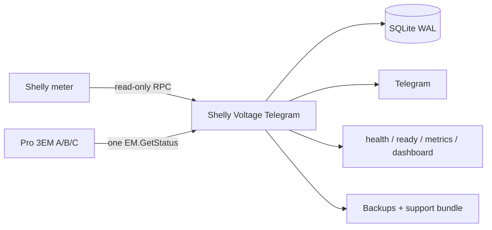

<p align="center">
  <a href="README_EN.md"></a>
  <a href="README_RU.md"></a>
  <a href="README_UA.md"></a>
</p>

<h1 align="center">⚡ Shelly Voltage Telegram</h1>
<p align="center"><strong>Local-first voltage, outage and power-quality monitoring for Shelly → Telegram.</strong></p>
<p align="center">Read-only by design · SQLite history · Prometheus metrics · Docker · Single-phase and three-phase ready</p>

<p align="center">
  <a href="https://github.com/iSentinel/shelly-voltage-telegram/releases/latest"></a>
  <a href="https://github.com/iSentinel/shelly-voltage-telegram/actions/workflows/ci.yml"></a>
  
  <a href="LICENSE"></a>
</p>

<p align="center">
  
</p>
<p align="center"><em>Real live dashboard captured from the hardware deployment. L1 is online; L2/L3 are ready for future sensors.</em></p>

---

## Overview

**Shelly Voltage Telegram** reads voltage and frequency from supported Shelly devices, stores valid measurements, detects confirmed outages and keeps a Telegram status message current.

The project is intentionally **monitor-only**: it does not switch relays, change Shelly configuration or control electrical loads.

<table>
<tr><td>🔒 <b>Read-only Shelly RPC</b></td><td>⚡ Voltage + frequency + quality</td></tr>
<tr><td>🔌 <b>Outage / recovery journal</b></td><td>📱 Telegram status, alerts, charts, CSV</td></tr>
<tr><td>🗄️ <b>SQLite WAL history</b></td><td>📊 Health, readiness, metrics, dashboard</td></tr>
<tr><td>🐳 <b>Hardened Docker runtime</b></td><td>3️⃣ Pro 3EM / 3CT63 ready</td></tr>
</table>

## Status

- Current software candidate: **0.5.6-hw**
- Current release: **0.5.5-hw**
- Production deployment: **0.5.4-hw**, hardware-accepted on a physical Shelly Pro EM-50 after live upgrade validation.
- Hardware-accepted live checkpoint: **0.5.4-hw**
- Release `0.5.5-hw` adds keyless Sigstore signing for versioned GHCR images; runtime monitoring behavior remains the hardware-accepted `0.5.4-hw` code path.
- Shelly Pro 3EM / Pro 3EM-3CT63 support is implemented and software-tested; physical three-phase validation follows after device installation.

## Supported devices

`Pro EM-50` · `EM Gen3` · `PM Mini Gen3` · `Plus PM Mini` · `Plus 1PM` · `1PM Gen3` · `1PM Gen4` · `1PM Mini Gen3` · `1PM Mini Gen4` · `Pro 3EM / Pro 3EM-3CT63`

The Shelly model is selected from the administrator `/settings` menu. Network addresses and credentials stay in deployment configuration and secret files.

## Architecture



## Install in one command

```bash
curl -fsSL https://raw.githubusercontent.com/iSentinel/shelly-voltage-telegram/main/scripts/bootstrap.sh | sudo bash
```

Safe dry run:

```bash
curl -fsSL https://raw.githubusercontent.com/iSentinel/shelly-voltage-telegram/main/scripts/bootstrap.sh \
  | sudo bash -s -- --dry-run --non-interactive
```

Then configure the deployment:

```bash
sudo ./scripts/configure.sh
```

## Telegram commands

```text
/start       /help         /voltage      /status
/today       /minmax       /history      /outages
/quality     /chart        /export       /summary
/device      /health       /settings     /audit
/maintenance
```

## Container image

```bash
docker pull ghcr.io/isentinel/shelly-voltage-telegram:v0.5.5-hw
```

Published for `linux/amd64` and `linux/arm64` with SBOM/provenance metadata.

## Documentation

- 🇬🇧 [English documentation](README_EN.md)
- 🇷🇺 [Русская документация](README_RU.md)
- 🇺🇦 [Українська документація](README_UA.md)
- 🧭 [Roadmap](ROADMAP.md)
- 🧪 [Hardware validation](HARDWARE_VALIDATION.md)
- 📝 [Changelog](CHANGELOG.md)


---

<p align="center"><strong>Monitor power. Keep history. Get notified. Never control the load.</strong></p>