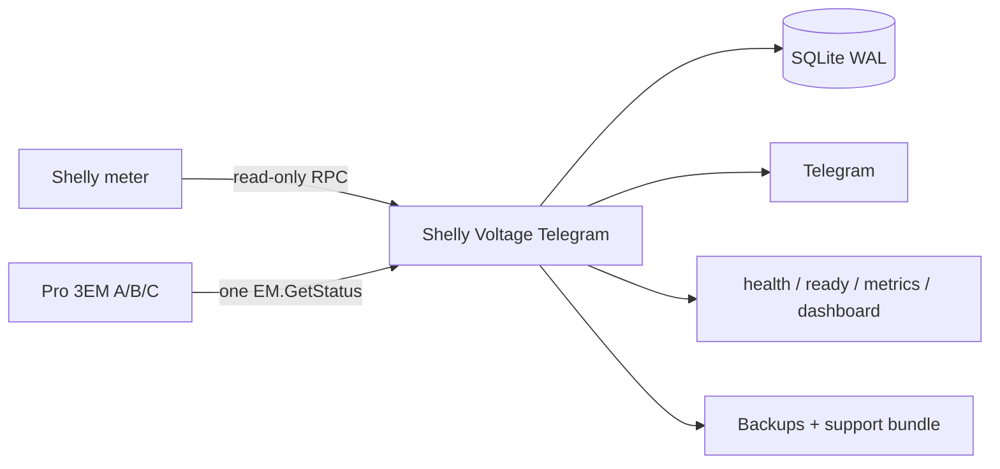

<p align="center">
  <a href="README_EN.md"></a>
  <a href="README_RU.md"></a>
  <a href="README_UA.md"></a>
</p>

<h1 align="center">⚡ Shelly Voltage Telegram</h1>
<p align="center"><strong>Local-first voltage, outage and power-quality monitoring for Shelly → Telegram.</strong></p>
<p align="center">Read-only by design · SQLite history · Prometheus metrics · Docker · Single-phase and three-phase ready</p>

<p align="center">
  <a href="https://github.com/iSentinel/shelly-voltage-telegram/releases/latest"></a>
  <a href="https://github.com/iSentinel/shelly-voltage-telegram/actions/workflows/ci.yml"></a>
  
  <a href="LICENSE"></a>
</p>

<p align="center">📦 <strong>Latest published GitHub Release:</strong> <a href="https://github.com/iSentinel/shelly-voltage-telegram/releases/latest">Open latest release and download</a> · <a href="https://github.com/iSentinel/shelly-voltage-telegram/releases">All releases</a></p>

<p align="center">
  
</p>
<p align="center"><em>Telegram voltage status message, cropped to the message boundaries.</em></p>

<p align="center">
  
</p>
<p align="center"><em>Field screenshot: 24-hour Telegram voltage chart with a 207 V warning line. Historical measurements; not a live voltage display.</em> <a href="docs/TELEGRAM_FIELD_SCREENSHOTS.md">QA context</a></p>

---

## Telegram menu / Меню Telegram

`/start` opens the bot menu. Status includes voltage and active settings.
Pro EM-50 and other single-phase models show `L`; Pro 3EM shows `L1/L2/L3`.
See [usage and compatibility / справка](docs/TELEGRAM_MENU.md).
The private administrator **Updates** menu checks GitHub Releases without
installing automatically; see [safe updates](docs/UPDATES.md).
Source release version: `0.5.19-hw`. Verify published assets and signatures at [GitHub Releases](https://github.com/iSentinel/shelly-voltage-telegram/releases). Last verified physical production runtime: `0.5.15-hw`; source publication is not installation.

## Overview

**Shelly Voltage Telegram** reads voltage and frequency from supported Shelly devices, stores valid measurements, detects confirmed outages and keeps a Telegram status message current.

The project is intentionally **monitor-only**: it does not switch relays, change Shelly configuration or control electrical loads.

<table>
<tr><td>🔒 <b>Read-only Shelly RPC</b></td><td>⚡ Voltage + frequency + quality</td></tr>
<tr><td>🔌 <b>Outage / recovery journal</b></td><td>📱 Telegram status, alerts, charts, CSV</td></tr>
<tr><td>🗄️ <b>SQLite WAL history</b></td><td>📊 Health, readiness, metrics, dashboard</td></tr>
<tr><td>🐳 <b>Hardened Docker runtime</b></td><td>3️⃣ Pro 3EM / 3CT63 ready</td></tr>
</table>

## Status

- Current source release version: **`0.5.19-hw`** (deployment is separately verified).
- Current release: **0.5.19-hw** (source version marker only; signed artifact publication must be verified at [GitHub Releases](https://github.com/iSentinel/shelly-voltage-telegram/releases) with source SHA256 and immutable Cosign identity).
- Production field-test runtime: **0.5.15-hw**, installed on the physical Shelly Pro EM-50; the last fully hardware-accepted electrical-transition checkpoint remains `0.5.6-hw`.
- Hardware-accepted live checkpoint: **0.5.6-hw**
- Release `0.5.9-hw` adds the 15-minute stable-recovery status rotation on top of the event summaries, RU/UA/EN UI, diagnostics, and unstable-grid indication from `0.5.8-hw`.
- Candidate `0.5.10-hw` extends the read-only recovery acceptance CLI so a natural 15-minute stable-recovery rotation can be verified without controlling Shelly or writing to the live database.
- `0.5.11-hw` replaces the oversized `/settings` keyboard with five compact sections and focused subpages. Existing callback actions remain compatible; reset now requires confirmation. Live promotion, exact-main parity, restart continuity and SQLite/Telegram continuity passed.
- A Telegram Mini App is planned as an optional settings frontend after a public HTTPS endpoint is available; the compact inline menu remains the no-extra-infrastructure fallback.
- It also migrates a persisted pre-`0.5.9-hw` recovery event into the stability timer so an old recovery banner cannot remain indefinitely after an upgrade.
- Shelly Pro 3EM / Pro 3EM-3CT63 support is implemented and software-tested; physical three-phase validation follows after device installation.

## Supported devices

`Pro EM-50` · `EM Gen3` · `PM Mini Gen3` · `Plus PM Mini` · `Plus 1PM` · `1PM Gen3` · `1PM Gen4` · `1PM Mini Gen3` · `1PM Mini Gen4` · `Pro 3EM / Pro 3EM-3CT63`

The Shelly model is selected from the administrator `/settings` menu. Network addresses and credentials stay in deployment configuration and secret files.

## Architecture



## Voltage alert status notifications

Low- and high-voltage transitions replace the shared Telegram status message
instead of creating separate alert messages. The new status is published first;
the previous status is deleted only after the replacement succeeds.

The first abnormal status may notify normally. Further abnormal replacements
inside the notification cooldown are silent. Recovery is always silent, and
quiet hours still force every message to be silent. The cooldown is counted
from the last loud voltage status and is not extended by silent replacements.

Default cooldown is 5 minutes. Administrators can select `Off`, `3`, `5`, or
`10` minutes from `/settings`. The value is persisted in SQLite and applies
without a restart. Set `VOLTAGE_NOTIFICATION_COOLDOWN_MIN` to change the
deployment default.


## 0.5.8 candidate features

- Final voltage-event summary after the fixed edit window: start/end, duration,
  min/max/average voltage from SQLite, transition count, and time outside normal.
- Telegram UI language can be switched at runtime between **RU / UA / EN** and
  is persisted in SQLite.
- `/settings` includes explicit **Test loud**, **Test silent**, and **Test edit**
  checks that do not alter real voltage-alert cooldown state.
- An optional instability indicator appears after four confirmed low/high/normal
  transitions within 15 minutes; transition history survives a restart.

## Install in one command

```bash
curl -fsSL https://raw.githubusercontent.com/iSentinel/shelly-voltage-telegram/main/scripts/bootstrap.sh | sudo bash
```

Safe dry run:

```bash
curl -fsSL https://raw.githubusercontent.com/iSentinel/shelly-voltage-telegram/main/scripts/bootstrap.sh \
  | sudo bash -s -- --dry-run --non-interactive
```

Then configure the deployment:

```bash
sudo ./scripts/configure.sh
```

## Telegram commands

The following commands are in the **source candidate**. Not all
commands are available in the currently published `0.5.14-hw` image.

```text
/start       /help         /voltage      /status
/today       /minmax       /history      /outages
/quality     /chart        /export       /summary
/events      /week         /device       /health
/settings    /audit        /maintenance
```

The administrator's **private chat** also supports `/preview`,
`/view compact`, `/view detailed`, `/week subscribe`, and
`/week unsubscribe`. These candidate-only controls do not modify
the public channel, are opt-in where applicable, and require a
validated production release before use.

## Container image

```bash
docker pull ghcr.io/isentinel/shelly-voltage-telegram:v0.5.15-hw
```

Published for `linux/amd64` and `linux/arm64` with SBOM/provenance metadata.

## Documentation

Troubleshooting: [Shelly online in the app, but offline in Telegram](docs/SHELLY_CONNECTIVITY.md).

- 🇬🇧 [English documentation](README_EN.md)
- 🇷🇺 [Русская документация](README_RU.md)
- 🇺🇦 [Українська документація](README_UA.md)
- 🔐 [Telegram administrator guide](docs/TELEGRAM_ADMIN_GUIDE.md)
- 💾 [Read-only backup validation](docs/BACKUP_VALIDATION.md)
- 🧪 [Offline backup restoration rehearsal (staged source)](docs/BACKUP_VALIDATION.md#offline-restoration-rehearsal-candidate-source-only)
- 🧭 [Roadmap](ROADMAP.md)
- 🧪 [Hardware validation](HARDWARE_VALIDATION.md)
- 📝 [Changelog](CHANGELOG.md)


---

<p align="center"><strong>Monitor power. Keep history. Get notified. Never control the load.</strong></p>

### Telegram status message

The edit window is configured in administrator `/settings`: 3, 5 or 10 minutes, with 10 minutes as the default (`VOLTAGE_STATUS_EDIT_WINDOW_MIN`). Its deadline starts with the first published voltage event. Low voltage, high voltage, recovery and repeated transitions within that deadline edit the same message, including after recovery. Edits do not extend the deadline. After expiry, the next transition publishes a new post, then unpins and deletes the previous post.

The audible notification cooldown is a separate setting. Editing a message is silent and does not change the last audible notification time. Quiet hours still apply to new posts. SQLite metadata preserves the setting, message ID and original deadline across restarts. Older databases use the configured default and reuse a recent stored voltage event when available; existing history is retained.


### Telegram status Design Polish v5 (source-only candidate)

The proposed Docker image installs Debian's Inter and Noto Sans font
packages and Pillow 11.3.x. It enables TELEGRAM_GRAPHIC_STYLE=v5, a
FreeType anti-aliased renderer with double-resolution Lanczos downsampling
to 960x800. No font installation is needed on the production host.
Design Polish v5.1 restores the detailed YASNO schedule: 24 labelled hours
in a 6-by-4 grid, independently colored half-hour segments, a clear
current-interval outline, and up to six chronological text rows showing
outage/supply start, end and duration (plus overflow count when needed).
This schedule is a forecast, not a measurement of mains availability.
The dependency-free v4 bitmap renderer remains available through
TELEGRAM_GRAPHIC_STYLE=v4. Unknown values fail closed.

For offline QA outside Docker, install Pillow into an isolated virtual
environment and use TELEGRAM_V5_FONT_ROOT to point at a separately
extracted copy of these licensed fonts. A generated preview is not proof
of Telegram recipient-visible acceptance and does not authorize public
status photo conversion or production deployment.
