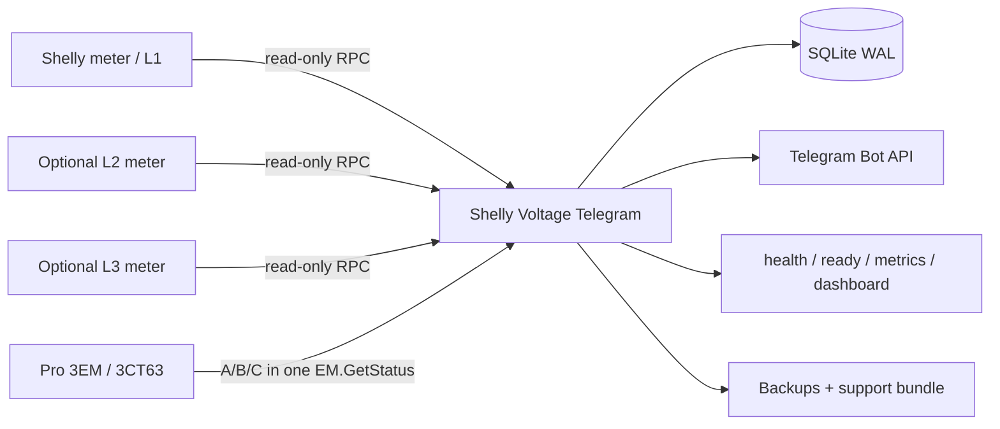

<p align="center">
  <a href="README.md"></a>
  <a href="README_RU.md"></a>
  <a href="README_UA.md"></a>
</p>

<h1 align="center">⚡ Shelly Voltage Telegram</h1>
<p align="center"><strong>Local-first voltage, outage and power-quality monitoring for Shelly devices with Telegram status and alerts.</strong></p>

<p align="center">
  <a href="https://github.com/iSentinel/shelly-voltage-telegram/releases/latest"></a>
  <a href="https://github.com/iSentinel/shelly-voltage-telegram/actions/workflows/ci.yml"></a>
  
  
  <a href="LICENSE"></a>
</p>

<p align="center">
  
</p>
<p align="center"><em>Telegram voltage status message, cropped to the message boundaries.</em></p>

---

## What it does

**Shelly Voltage Telegram** continuously reads voltage and frequency from supported Shelly meters, stores valid measurements in SQLite, detects confirmed outages, and keeps a Telegram status message up to date.

The service is designed as a **monitor only**. It does not switch relays, change Shelly configuration, or control electrical loads.

| | |
| --- | --- |
| 🔒 **Read-only** | Uses Shelly status RPC calls only. No control RPC is sent. |
| ⚡ **Voltage monitoring** | Voltage, frequency, min/max/average, history and quality statistics. |
| 🔌 **Outage tracking** | Hysteresis, outage journal, recovery duration and stable Telegram state. |
| 📱 **Telegram** | Stable status post, alerts, charts, CSV export and admin settings. |
| 📊 **Observability** | `/health`, `/ready`, `/status.json`, `/metrics`, local dashboard. |
| 🗄️ **SQLite WAL** | Durable history, settings, audit log and outage records. |
| 🐳 **Docker** | Hardened non-root container, Compose, systemd integration and backups. |
| 3️⃣ **Three-phase ready** | Native Pro 3EM/3CT63 backend plus optional separate L2/L3 meters. |

## Project status

- **Current software candidate: `0.5.11-hw`**
- **Current release: `0.5.10-hw`**
- **Production deployment: `0.5.10-hw`**, live on the physical Shelly Pro EM-50; the last fully hardware-accepted electrical-transition checkpoint remains `0.5.6-hw`.
- **Hardware-accepted live checkpoint: `0.5.6-hw`**.
- Candidate `0.5.9-hw` silently replaces an unchanged recovery post with a fresh current-status post after 15 stable minutes.
- Candidate `0.5.10-hw` adds read-only field acceptance for the natural 15-minute stable-recovery status rotation.
- Candidate `0.5.11-hw` introduces a compact five-section `/settings` UI with focused subpages and reset confirmation; Mini App support is planned after HTTPS is available.
- It also restores a missing stability timer for a persisted legacy recovery event after an upgrade.
- Native Shelly Pro 3EM / Pro 3EM-3CT63 support is software-tested; physical three-phase validation follows after device installation.

## Supported Shelly models

The model can be selected from the administrator `/settings` menu. Network addresses and credentials stay outside Telegram in `.env` and secret files.

| Shelly model | Phases | Read-only RPC |
| --- | ---: | --- |
| Pro EM-50 | 1 | `EM1.GetStatus` |
| EM Gen3 | 1 | `EM1.GetStatus` |
| PM Mini Gen3 | 1 | `PM1.GetStatus` |
| Plus PM Mini | 1 | `PM1.GetStatus` |
| Plus 1PM | 1 | `Switch.GetStatus` |
| 1PM Gen3 | 1 | `Switch.GetStatus` |
| 1PM Gen4 | 1 | `Switch.GetStatus` |
| 1PM Mini Gen3 | 1 | `Switch.GetStatus` |
| 1PM Mini Gen4 | 1 | `Switch.GetStatus` |
| Pro 3EM / Pro 3EM-3CT63 | 3 | `EM.GetStatus` |

> **Important:** PM Mini and 1PM devices are inline devices and must only be used within their electrical ratings. For whole-home or three-phase measurement, a CT-based Shelly meter is usually the better choice.

## Architecture



For a Pro 3EM in `triphase` mode, one polling cycle maps phase **A → L1**, **B → L2**, **C → L3** with the same local timestamp.

## Voltage alert status notifications

Low- and high-voltage transitions replace the shared Telegram status message
instead of creating separate alert messages. The new status is published first;
the previous status is deleted only after the replacement succeeds.

The first abnormal status may notify normally. Further abnormal replacements
inside the notification cooldown are silent. Recovery is always silent, and
quiet hours still force every message to be silent. The cooldown is counted
from the last loud voltage status and is not extended by silent replacements.

Default cooldown is 5 minutes. Administrators can select `Off`, `3`, `5`, or
`10` minutes from `/settings`. The value is persisted in SQLite and applies
without a restart. Set `VOLTAGE_NOTIFICATION_COOLDOWN_MIN` to change the
deployment default.

## Quick install

### One-line install

```bash
curl -fsSL https://raw.githubusercontent.com/iSentinel/shelly-voltage-telegram/main/scripts/bootstrap.sh | sudo bash
```

### Safe dry run

```bash
curl -fsSL https://raw.githubusercontent.com/iSentinel/shelly-voltage-telegram/main/scripts/bootstrap.sh \
  | sudo bash -s -- --dry-run --non-interactive
```

### Manual install

```bash
git clone https://github.com/iSentinel/shelly-voltage-telegram.git
cd shelly-voltage-telegram
sudo ./scripts/install.sh
```

The installer preserves existing `.env`, secret files, SQLite data and backups during updates.

## First configuration

Use the secure configurator:

```bash
sudo ./scripts/configure.sh
```

It configures the Shelly host/model, Telegram control chat, optional status channel and administrator IDs. Passwords and the bot token are stored in dedicated secret files.

Example configuration:

```text
SHELLY_METER_TYPE=pro_em50
SHELLY_HOST=<shelly-address>
TELEGRAM_CHAT_ID=<private-control-chat>
TELEGRAM_STATUS_CHAT_ID=<status-channel>
TELEGRAM_ADMIN_USER_IDS=<telegram-user-id>
```

For Pro 3EM / 3CT63:

```text
SHELLY_METER_TYPE=pro3em
SHELLY_HOST=<pro-3em-address>
```

## Telegram experience

The bot separates the **private control chat** from the optional **status channel**. Commands and administrator settings stay private; the stable voltage status can live in a channel.

When a confirmed outage recovers, the old outage-era status post is deleted and a fresh online status post is created. Its new `message_id` is persisted for future edits.

Available commands include:

```text
/start       /help         /voltage      /status
/today       /minmax       /history      /outages
/quality     /chart        /export       /summary
/device      /health       /settings     /audit
/maintenance
```

Useful examples:

```text
/chart L1 24
/export L1 24
/quality L1 24
/maintenance 60
/maintenance off
```

## Monitoring rules

- Default polling interval: **10 seconds**.
- Default offline confirmation: **3 failed polls**.
- Default recovery confirmation: **2 successful polls**.
- Invalid/unavailable readings are **not stored as fake `0 V` samples**.
- Raw history retention is configurable; hourly aggregates are created before pruning.
- Low-voltage thresholds are configurable; L1/L2/L3 low/recovery events are shown in the stable status header instead of separate private messages.
- Warning/critical thresholds are user settings, not claimed electrical-code limits.

## HTTP endpoints

The local HTTP service is read-only:

```bash
curl http://127.0.0.1:8080/health
curl http://127.0.0.1:8080/ready
curl http://127.0.0.1:8080/status.json
curl http://127.0.0.1:8080/metrics
```

When a phase is `starting` or `offline`, current Prometheus voltage and
frequency metrics are exported as `NaN` instead of repeating the last good
sample. During `recovering` and `online`, the newest valid sample is exported.

Dashboard:

```text
http://127.0.0.1:8080/dashboard
```

The local dashboard follows the same rule: offline/starting phase cards show no current voltage; recovering/online cards show the newest valid sample.
Telegram stable status also hides last-good V/Hz while the phase is offline; the diagnostic `/health` endpoint still retains the last valid sample together with explicit connectivity state.

## Diagnostics and backups

```bash
# Shelly + SQLite + Telegram diagnostic check
docker exec shelly-voltage-bot python /app/app.py doctor

# 24-hour report
./scripts/soak-report.py --hours 24 --json

# Capture the current outage before power returns
./scripts/recovery-acceptance.py \
  --db /var/lib/shelly-voltage/voltage.sqlite3 \
  baseline --output recovery-baseline.json

# Verify the same outage after power returns
./scripts/recovery-acceptance.py \
  --db /var/lib/shelly-voltage/voltage.sqlite3 \
  verify --baseline recovery-baseline.json

# Run the single read-only pre-promotion gate
./scripts/promotion-check.py --baseline recovery-baseline.json

# Online SQLite backup
./scripts/backup.sh

# Redacted support bundle
./scripts/support-bundle.sh

# Validate rollback
sudo ./scripts/rollback.sh --dry-run
```

Recovery verification and promotion JSON keep deployment-specific connection errors and raw Telegram status message IDs out of operator reports.
New recovery baselines store a SHA-256 fingerprint of the Telegram status message ID instead of the raw ID. Existing legacy baselines remain supported.

All user-facing scripts provide `-h` / `--help`.

## Security

- Runs as non-root UID `10001`.
- Read-only container root filesystem.
- Linux capabilities dropped.
- `no-new-privileges` enabled.
- PID and memory limits in Compose.
- HTTP port bound to localhost by default.
- Secret files use restrictive permissions.
- `.env`, `secrets/`, SQLite data and validation evidence are excluded from public release archives.
- Support bundles redact secret-like fields.
- Shelly HTTP Digest authentication is supported.
- The project never needs Shelly Cloud, MQTT, Home Assistant, Zigbee or an ESP32.

> Do not expose Shelly RPC directly to the public Internet.

## Container image

Release image:

```bash
docker pull ghcr.io/isentinel/shelly-voltage-telegram:v0.5.9-hw
```

The release image is multi-architecture (`linux/amd64`, `linux/arm64`) and is published with SBOM/provenance metadata. Versioned GHCR images remain keylessly signed with Sigstore Cosign.


## Roadmap

- physical validation with **Shelly Pro 3EM-3CT63**;
- richer three-phase dashboard and charts;
- continued installer and upgrade-path hardening;
- maintainability audit and modularization without changing monitor behavior.

See [`ROADMAP.md`](ROADMAP.md) and [`HARDWARE_VALIDATION.md`](HARDWARE_VALIDATION.md) for detailed engineering status.

## License

See [`LICENSE`](LICENSE).

---

<p align="center">
  <strong>Monitor power. Keep history. Get notified. Never control the load.</strong>
</p>

## Development quality gate

Run the same pinned quality checks used by GitHub CI:

```bash
./scripts/quality.sh
```

The command requires Ruff 0.14.2 and fails closed if Ruff is missing or a different version is installed.

### Telegram status message

The edit window is configured in administrator `/settings`: 3, 5 or 10 minutes, with 10 minutes as the default (`VOLTAGE_STATUS_EDIT_WINDOW_MIN`). Its deadline starts with the first published voltage event. Low voltage, high voltage, recovery and repeated transitions within that deadline edit the same message, including after recovery. Edits do not extend the deadline. After expiry, the next transition publishes a new post, then unpins and deletes the previous post.

The audible notification cooldown is a separate setting. Editing a message is silent and does not change the last audible notification time. Quiet hours still apply to new posts. SQLite metadata preserves the setting, message ID and original deadline across restarts. Older databases use the configured default and reuse a recent stored voltage event when available; existing history is retained.

## 0.5.8 candidate features

The candidate adds a finalized voltage-event summary, persistent RU/UA/EN Telegram UI selection, explicit loud/silent/edit notification tests, and a restart-persistent unstable-grid indicator triggered by four confirmed state transitions in 15 minutes. Test notifications never advance the real voltage-alert sound cooldown.

