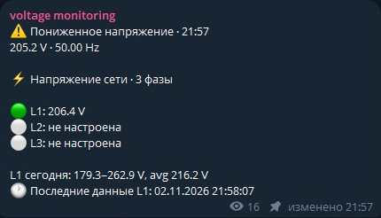
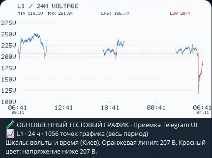
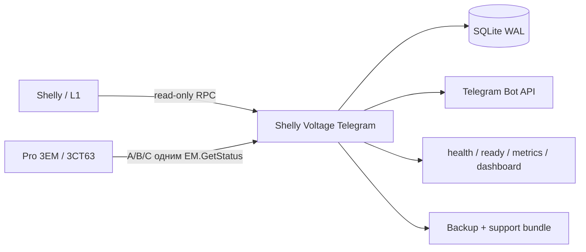

<p align="center">
  <a href="README.md"></a>
  <a href="README_RU.md"></a>
  <a href="README_UA.md"></a>
</p>

<h1 align="center">⚡ Shelly Voltage Telegram</h1>
<p align="center"><strong>Локальный мониторинг напряжения, отключений и качества сети для Shelly с Telegram-статусом и уведомлениями.</strong></p>

<p align="center">
  <a href="https://github.com/iSentinel/shelly-voltage-telegram/releases/latest"></a>
  <a href="https://github.com/iSentinel/shelly-voltage-telegram/actions/workflows/ci.yml"></a>
  
  
  <a href="LICENSE"></a>
</p>

<p align="center">📦 <strong>Последний опубликованный релиз:</strong> <a href="https://github.com/iSentinel/shelly-voltage-telegram/releases/latest">Посмотреть и скачать</a> · <a href="https://github.com/iSentinel/shelly-voltage-telegram/releases">Все релизы</a></p>

<p align="center">
  
</p>
<p align="center"><em>Сообщение бота о напряжении в Telegram. Оставлено только само сообщение.</em></p>

<p align="center">
  
</p>
<p align="center"><em>Реальный скриншот 24-часового графика с порогом 207 В. Исторические измерения, не текущее напряжение.</em> <a href="docs/TELEGRAM_FIELD_SCREENSHOTS.md">QA context</a></p>

---

## Telegram menu / Меню Telegram

`/start` opens the bot menu. Status includes voltage and active settings.
Pro EM-50 and other single-phase models show `L`; Pro 3EM shows `L1/L2/L3`.
See [usage and compatibility / справка](docs/TELEGRAM_MENU.md).
Последний подписанный релиз GitHub: `0.5.16-hw`; production на сервере: `0.5.15-hw`. Следующий кандидат исходников: `0.5.17-hw` (не опубликован и не установлен).

## Что делает проект

**Shelly Voltage Telegram** регулярно считывает напряжение и частоту с поддерживаемых Shelly, сохраняет корректные измерения в SQLite, фиксирует подтверждённые отключения и поддерживает актуальное статус-сообщение в Telegram.

Проект работает только как **монитор**. Он не переключает реле, не меняет конфигурацию Shelly и не управляет электрической нагрузкой.

| | |
| --- | --- |
| 🔒 **Только чтение** | Используются только RPC получения состояния Shelly. |
| ⚡ **Напряжение и частота** | Текущие значения, min/max/avg, история и статистика качества. |
| 🔌 **Отключения** | Гистерезис, журнал отключений, длительность и восстановление. |
| 📱 **Telegram** | Стабильный статус, уведомления, графики, CSV и настройки администратора. |
| 📊 **Наблюдаемость** | `/health`, `/ready`, `/status.json`, `/metrics`, локальный dashboard. |
| 🗄️ **SQLite WAL** | История, runtime-настройки, аудит и outage-журнал. |
| 🐳 **Docker** | Непривилегированный контейнер, Compose, systemd и резервные копии. |
| 3️⃣ **Готовность к 3 фазам** | Pro 3EM/3CT63: L1/L2/L3; однофазные модели: L. |

## Статус проекта

- Текущий software candidate: **`0.5.17-hw`** (ещё не опубликован).
- Последний подписанный публичный релиз: **`0.5.16-hw`**.
- Тестовая production-установка использует **`0.5.15-hw`** с физическим Shelly Pro EM-50; последним полностью аппаратно подтверждённым checkpoint остаётся `0.5.6-hw`.
- Аппаратно подтверждённый live checkpoint: **`0.5.6-hw`**.
- Candidate `0.5.9-hw` через 15 минут стабильного восстановления бесшумно заменяет recovery-сообщение новым актуальным статусом.
- Candidate `0.5.10-hw` добавляет read-only полевую проверку естественной 15-минутной ротации статуса после восстановления.
- `0.5.11-hw` заменяет большое `/settings` на пять компактных разделов с отдельными экранами и подтверждением сброса; Mini App планируется после появления HTTPS.
- Также восстанавливается отсутствующий 15-минутный timer для сохранённого legacy recovery-события после обновления.
- Поддержка Shelly Pro 3EM / Pro 3EM-3CT63 реализована и проверена программно; физическая трёхфазная проверка будет выполнена после установки устройства.

## Поддерживаемые Shelly

Модель можно выбрать через административное меню `/settings`. IP-адреса и учётные данные не редактируются через Telegram и остаются в `.env`/secret-файлах.

| Модель | Фазы | RPC только для чтения |
| --- | ---: | --- |
| Shelly Pro EM-50 | 1 | `EM1.GetStatus` |
| Shelly EM Gen3 | 1 | `EM1.GetStatus` |
| Shelly PM Mini Gen3 | 1 | `PM1.GetStatus` |
| Shelly Plus PM Mini | 1 | `PM1.GetStatus` |
| Shelly Plus 1PM | 1 | `Switch.GetStatus` |
| Shelly 1PM Gen3 | 1 | `Switch.GetStatus` |
| Shelly 1PM Gen4 | 1 | `Switch.GetStatus` |
| Shelly 1PM Mini Gen3 | 1 | `Switch.GetStatus` |
| Shelly 1PM Mini Gen4 | 1 | `Switch.GetStatus` |
| Shelly Pro 3EM / Pro 3EM-3CT63 | 3 | `EM.GetStatus` |

> **Важно:** PM Mini и 1PM включаются непосредственно в измеряемую цепь и должны использоваться только в пределах их электрических характеристик. Для ввода дома или трёх фаз обычно лучше CT-модель.

## Архитектура



Для Pro 3EM в режиме `triphase` один цикл опроса раскладывает **A → L1**, **B → L2**, **C → L3** с общей временной меткой.

## Уведомления о напряжении в общем статусе

Пониженное и повышенное напряжение публикуются как новая версия общего
Telegram status-сообщения, а не отдельными alert-сообщениями. Сначала бот
публикует новый status и только после успешной публикации удаляет предыдущий.

Первый ненормальный status может прийти с обычным звуковым уведомлением.
Следующие ненормальные status-сообщения внутри cooldown публикуются тихо.
Восстановление всегда тихое, а ночной режим по-прежнему принудительно
отключает звук у всех сообщений. Cooldown считается от последнего громкого
voltage status и не продлевается тихими обновлениями.

По умолчанию cooldown равен 5 минутам. Администратор может выбрать `Off`, `3`,
`5` или `10` минут через `/settings`. Значение хранится в SQLite и применяется
без перезапуска. Deployment default задаётся через
`VOLTAGE_NOTIFICATION_COOLDOWN_MIN`.

## Быстрая установка

### Установка одной командой

```bash
curl -fsSL https://raw.githubusercontent.com/iSentinel/shelly-voltage-telegram/main/scripts/bootstrap.sh | sudo bash
```

### Безопасная проверка без установки

```bash
curl -fsSL https://raw.githubusercontent.com/iSentinel/shelly-voltage-telegram/main/scripts/bootstrap.sh \
  | sudo bash -s -- --dry-run --non-interactive
```

### Ручная установка

```bash
git clone https://github.com/iSentinel/shelly-voltage-telegram.git
cd shelly-voltage-telegram
sudo ./scripts/install.sh
```

При обновлении installer сохраняет существующие `.env`, secrets, SQLite и резервные копии.

## Первичная настройка

Запустите безопасный конфигуратор:

```bash
sudo ./scripts/configure.sh
```

Он настраивает модель и адрес Shelly, приватный Telegram control chat, отдельный status channel и список администраторов. Токен бота и пароли сохраняются в отдельных secret-файлах.

Пример:

```text
SHELLY_METER_TYPE=pro_em50
SHELLY_HOST=<адрес-shelly>
TELEGRAM_CHAT_ID=<приватный-control-chat>
TELEGRAM_STATUS_CHAT_ID=<status-channel>
TELEGRAM_ADMIN_USER_IDS=<telegram-user-id>
```

Для Pro 3EM / 3CT63:

```text
SHELLY_METER_TYPE=pro3em
SHELLY_HOST=<адрес-pro-3em>
```

## Telegram

Приватный чат управления и канал статуса разделены. Команды и административные настройки остаются в control chat, а постоянный статус можно публиковать в отдельный канал.

После подтверждённого восстановления питания бот удаляет старое outage-status сообщение и создаёт новое online-status сообщение. Новый `message_id` сохраняется в SQLite и используется для последующих обновлений.

Основные команды:

```text
/start       /help         /voltage      /status
/today       /minmax       /history      /outages
/quality     /chart        /export       /summary
/device      /health       /settings     /audit
/maintenance
```

Примеры:

```text
/chart L1 24
/export L1 24
/quality L1 24
/maintenance 60
/maintenance off
```

## Правила мониторинга

- Опрос по умолчанию: **каждые 10 секунд**.
- Offline подтверждается после **3 неудачных опросов**.
- Recovery подтверждается после **2 успешных опросов**.
- Недоступный Shelly не создаёт искусственные записи `0 V`.
- Срок хранения raw-данных настраивается; перед удалением создаются hourly aggregates.
- Пороги low-voltage и warning/critical настраиваются; события просадки/восстановления L1/L2/L3 выводятся в шапке стабильного статуса вместо отдельных личных сообщений.
- Значения warning/critical являются настройками проекта, а не заявленными нормативными пределами.

## HTTP и Prometheus

```bash
curl http://127.0.0.1:8080/health
curl http://127.0.0.1:8080/ready
curl http://127.0.0.1:8080/status.json
curl http://127.0.0.1:8080/metrics
```

Когда фаза имеет состояние `starting` или `offline`, текущие Prometheus-метрики
напряжения и частоты отдаются как `NaN`, а не повторяют последний хороший
замер. В состояниях `recovering` и `online` публикуется новый валидный замер.

Dashboard:

```text
http://127.0.0.1:8080/dashboard
```

Локальный dashboard следует тому же правилу: для offline/starting текущее напряжение не показывается; для recovering/online отображается только новый валидный замер.
Стабильный статус Telegram также скрывает последний V/Hz, пока фаза offline; диагностический `/health` сохраняет последний валидный замер вместе с явным состоянием connectivity.

## Диагностика и резервные копии

Если Shelly доступен в фирменном приложении, но бот показывает offline, см. [проверку локального подключения](docs/SHELLY_CONNECTIVITY.md).

```bash
# Проверка Shelly + SQLite + Telegram
docker exec shelly-voltage-bot python /app/app.py doctor

# Отчёт за 24 часа
./scripts/soak-report.py --hours 24 --json

# Сохранить baseline текущего отключения до возврата питания
./scripts/recovery-acceptance.py \
  --db /var/lib/shelly-voltage/voltage.sqlite3 \
  baseline --output recovery-baseline.json

# Проверить то же отключение после возврата питания
./scripts/recovery-acceptance.py \
  --db /var/lib/shelly-voltage/voltage.sqlite3 \
  verify --baseline recovery-baseline.json

# Единая read-only проверка перед обновлением production
./scripts/promotion-check.py --baseline recovery-baseline.json

# Online backup SQLite
./scripts/backup.sh

# Проверка восстановления копий в изоляции (только staging-исходники)
python scripts/restore-drill.py --help
python scripts/restore-drill.py --backup-dir /var/backups/shelly-voltage --count 3 --jsonl

# Обезличенный support bundle
./scripts/support-bundle.sh

# Проверка rollback
sudo ./scripts/rollback.sh --dry-run
```

JSON-отчёты recovery verification и promotion не выводят deployment-specific текст сетевых ошибок и сырой Telegram `message_id`.
Новые recovery baseline сохраняют SHA-256 fingerprint Telegram status message ID вместо сырого ID. Старые baseline-файлы остаются совместимыми.

Все пользовательские скрипты поддерживают `-h` / `--help`.

## Безопасность

- Контейнер запускается от UID `10001`, не от root.
- Root filesystem контейнера read-only.
- Linux capabilities удалены.
- Включён `no-new-privileges`.
- Заданы PID/memory limits.
- HTTP-порт по умолчанию доступен только через localhost.
- Secrets имеют ограниченные права доступа.
- `.env`, `secrets/`, SQLite и локальные validation-файлы не попадают в публичные релизы.
- Support bundle удаляет секретные значения.
- Поддерживается HTTP Digest authentication Shelly.
- Shelly Cloud, MQTT, Home Assistant, Zigbee и ESP32 не требуются.

> Не публикуйте Shelly RPC напрямую в Интернет.

## Docker image

```bash
docker pull ghcr.io/isentinel/shelly-voltage-telegram:v0.5.9-hw
```

Образ выпускается для `linux/amd64` и `linux/arm64` с SBOM и provenance metadata. Versioned GHCR-образы подписываются keyless-подписью Sigstore Cosign.


## Roadmap

- аппаратная проверка **Shelly Pro 3EM-3CT63**;
- более информативный трёхфазный dashboard и графики;
- дальнейшее усиление installer/upgrade path;
- продолжение maintainability-аудита и модульного разделения без изменения monitor-only поведения.

Подробности: [`ROADMAP.md`](ROADMAP.md) и [`HARDWARE_VALIDATION.md`](HARDWARE_VALIDATION.md).

## Лицензия

См. [`LICENSE`](LICENSE).

---

<p align="center"><strong>Контролируем состояние сети. Храним историю. Уведомляем. Никогда не управляем нагрузкой.</strong></p>

## Проверка качества при разработке

Локально запускайте тот же закреплённый набор проверок, что и GitHub CI:

```bash
./scripts/quality.sh
```

Команда требует Ruff 0.14.2 и завершается с ошибкой, если Ruff отсутствует или установлена другая версия.

### Сообщение статуса Telegram

Окно редактирования выбирается в административном меню `/settings`: 3, 5 или 10 минут, по умолчанию 10 минут (`VOLTAGE_STATUS_EDIT_WINDOW_MIN`). Отсчёт начинается с первого опубликованного события напряжения. Низкое напряжение, высокое напряжение, восстановление и повторные переходы внутри окна редактируют одно сообщение, в том числе после восстановления. Редактирование не продлевает окно. После его окончания следующий переход создаёт новый пост, затем старый пост открепляется и удаляется.

Звуковой интервал задаётся отдельно. Редактирование сообщения проходит без звука и не меняет время последнего звукового уведомления. Ночной режим продолжает действовать для новых постов. Настройка, номер сообщения и начало окна сохраняются в SQLite после перезапуска. Для старой базы применяется значение из конфигурации; недавнее сохранённое событие позволяет продолжить редактирование текущего сообщения без удаления истории.

## Возможности кандидата 0.5.8

Кандидат добавляет итог события напряжения после завершения окна редактирования, выбор языка Telegram RU/UA/EN с сохранением, тесты громкого/тихого уведомления и редактирования, а также сохраняемый после перезапуска индикатор нестабильной сети при четырёх подтверждённых переходах за 15 минут. Тестовые уведомления не изменяют реальный cooldown тревог.

