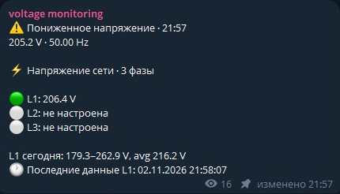
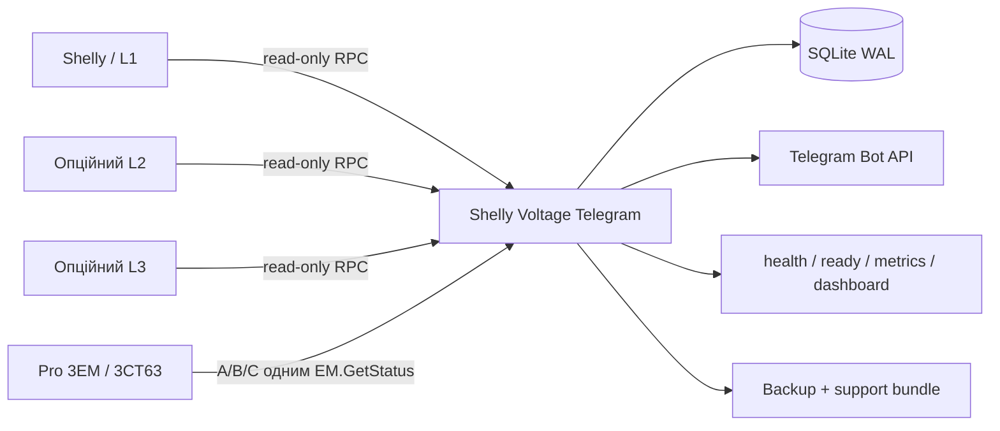

<p align="center">
  <a href="README.md"></a>
  <a href="README_RU.md"></a>
  <a href="README_UA.md"></a>
</p>

<h1 align="center">⚡ Shelly Voltage Telegram</h1>
<p align="center"><strong>Локальний моніторинг напруги, відключень і якості мережі для Shelly зі статусом та сповіщеннями в Telegram.</strong></p>

<p align="center">
  <a href="https://github.com/iSentinel/shelly-voltage-telegram/releases/latest"></a>
  <a href="https://github.com/iSentinel/shelly-voltage-telegram/actions/workflows/ci.yml"></a>
  
  
  <a href="LICENSE"></a>
</p>

<p align="center">
  
</p>
<p align="center"><em>Повідомлення бота про напругу в Telegram. Залишено лише саме повідомлення.</em></p>

---

## Що робить проєкт

**Shelly Voltage Telegram** регулярно зчитує напругу та частоту з підтримуваних Shelly, зберігає коректні вимірювання в SQLite, фіксує підтверджені відключення та підтримує актуальне статус-повідомлення в Telegram.

Проєкт працює лише як **монітор**. Він не перемикає реле, не змінює конфігурацію Shelly та не керує електричним навантаженням.

| | |
| --- | --- |
| 🔒 **Тільки читання** | Використовуються лише RPC отримання стану Shelly. |
| ⚡ **Напруга та частота** | Поточні значення, min/max/avg, історія та статистика якості. |
| 🔌 **Відключення** | Гістерезис, журнал відключень, тривалість і відновлення. |
| 📱 **Telegram** | Стабільний статус, сповіщення, графіки, CSV і налаштування адміністратора. |
| 📊 **Спостережуваність** | `/health`, `/ready`, `/status.json`, `/metrics`, локальний dashboard. |
| 🗄️ **SQLite WAL** | Історія, runtime-налаштування, аудит і журнал відключень. |
| 🐳 **Docker** | Непривілейований контейнер, Compose, systemd та резервні копії. |
| 3️⃣ **Готовність до 3 фаз** | Нативний Pro 3EM/3CT63 та окремі L2/L3 за потреби. |

## Статус проєкту

- Поточний software candidate: **`0.5.10-hw`**.
- Поточний публічний реліз: **`0.5.10-hw`**.
- Production використовує **`0.5.10-hw`** на фізичному Shelly Pro EM-50; останнім повністю апаратно підтвердженим checkpoint залишається `0.5.6-hw`.
- Апаратно підтверджений live checkpoint: **`0.5.6-hw`**.
- Candidate `0.5.9-hw` після 15 хвилин стабільного відновлення беззвучно замінює recovery-повідомлення новим актуальним статусом.
- Candidate `0.5.10-hw` додає read-only польову перевірку природної 15-хвилинної ротації статусу після відновлення.
- Також відновлюється відсутній 15-хвилинний timer для збереженої legacy recovery-події після оновлення.
- Підтримка Shelly Pro 3EM / Pro 3EM-3CT63 реалізована та перевірена програмно; фізична трифазна перевірка буде виконана після встановлення пристрою.

## Підтримувані Shelly

Модель можна вибрати через адміністративне меню `/settings`. IP-адреси та облікові дані не редагуються через Telegram і залишаються в `.env`/secret-файлах.

| Модель | Фази | RPC лише для читання |
| --- | ---: | --- |
| Shelly Pro EM-50 | 1 | `EM1.GetStatus` |
| Shelly EM Gen3 | 1 | `EM1.GetStatus` |
| Shelly PM Mini Gen3 | 1 | `PM1.GetStatus` |
| Shelly Plus PM Mini | 1 | `PM1.GetStatus` |
| Shelly Plus 1PM | 1 | `Switch.GetStatus` |
| Shelly 1PM Gen3 | 1 | `Switch.GetStatus` |
| Shelly 1PM Gen4 | 1 | `Switch.GetStatus` |
| Shelly 1PM Mini Gen3 | 1 | `Switch.GetStatus` |
| Shelly 1PM Mini Gen4 | 1 | `Switch.GetStatus` |
| Shelly Pro 3EM / Pro 3EM-3CT63 | 3 | `EM.GetStatus` |

> **Важливо:** PM Mini та 1PM вмикаються безпосередньо у вимірюваний ланцюг і мають використовуватися тільки в межах своїх електричних характеристик. Для вводу будинку або трьох фаз зазвичай краще підходить CT-модель.

## Архітектура



Для Pro 3EM у режимі `triphase` один цикл опитування розкладає **A → L1**, **B → L2**, **C → L3** з однією локальною часовою міткою.

## Сповіщення про напругу в загальному статусі

Знижена та підвищена напруга публікуються як нова версія загального Telegram
status-повідомлення, а не окремими alert-повідомленнями. Спочатку бот публікує
новий status і лише після успішної публікації видаляє попередній.

Перший ненормальний status може надійти зі звичайним звуковим сповіщенням.
Наступні ненормальні status-повідомлення всередині cooldown публікуються тихо.
Відновлення завжди тихе, а нічний режим і далі примусово вимикає звук для всіх
повідомлень. Cooldown рахується від останнього гучного voltage status і не
продовжується тихими оновленнями.

За замовчуванням cooldown дорівнює 5 хвилинам. Адміністратор може вибрати
`Off`, `3`, `5` або `10` хвилин через `/settings`. Значення зберігається в
SQLite і застосовується без перезапуску. Deployment default задається через
`VOLTAGE_NOTIFICATION_COOLDOWN_MIN`.

## Швидке встановлення

### Встановлення однією командою

```bash
curl -fsSL https://raw.githubusercontent.com/iSentinel/shelly-voltage-telegram/main/scripts/bootstrap.sh | sudo bash
```

### Безпечна перевірка без встановлення

```bash
curl -fsSL https://raw.githubusercontent.com/iSentinel/shelly-voltage-telegram/main/scripts/bootstrap.sh \
  | sudo bash -s -- --dry-run --non-interactive
```

### Ручне встановлення

```bash
git clone https://github.com/iSentinel/shelly-voltage-telegram.git
cd shelly-voltage-telegram
sudo ./scripts/install.sh
```

Під час оновлення installer зберігає наявні `.env`, secrets, SQLite та резервні копії.

## Початкове налаштування

Запустіть безпечний конфігуратор:

```bash
sudo ./scripts/configure.sh
```

Він налаштовує модель та адресу Shelly, приватний Telegram control chat, окремий status channel та список адміністраторів. Токен бота й паролі зберігаються в окремих secret-файлах.

Приклад:

```text
SHELLY_METER_TYPE=pro_em50
SHELLY_HOST=<адреса-shelly>
TELEGRAM_CHAT_ID=<приватний-control-chat>
TELEGRAM_STATUS_CHAT_ID=<status-channel>
TELEGRAM_ADMIN_USER_IDS=<telegram-user-id>
```

Для Pro 3EM / 3CT63:

```text
SHELLY_METER_TYPE=pro3em
SHELLY_HOST=<адреса-pro-3em>
```

## Telegram

Приватний чат керування та канал статусу розділені. Команди й адміністративні налаштування залишаються в control chat, а постійний статус можна публікувати в окремий канал.

Після підтвердженого відновлення живлення бот видаляє старе outage-status повідомлення та створює нове online-status повідомлення. Новий `message_id` зберігається в SQLite та використовується для наступних оновлень.

Основні команди:

```text
/start       /help         /voltage      /status
/today       /minmax       /history      /outages
/quality     /chart        /export       /summary
/device      /health       /settings     /audit
/maintenance
```

Приклади:

```text
/chart L1 24
/export L1 24
/quality L1 24
/maintenance 60
/maintenance off
```

## Правила моніторингу

- Опитування за замовчуванням: **кожні 10 секунд**.
- Offline підтверджується після **3 невдалих опитувань**.
- Recovery підтверджується після **2 успішних опитувань**.
- Недоступний Shelly не створює штучних записів `0 V`.
- Термін зберігання raw-даних налаштовується; перед видаленням створюються hourly aggregates.
- Пороги low-voltage і warning/critical налаштовуються; події просідання/відновлення L1/L2/L3 показуються в шапці стабільного статусу замість окремих приватних повідомлень.
- Значення warning/critical є налаштуваннями проєкту, а не заявленими нормативними межами.

## HTTP та Prometheus

```bash
curl http://127.0.0.1:8080/health
curl http://127.0.0.1:8080/ready
curl http://127.0.0.1:8080/status.json
curl http://127.0.0.1:8080/metrics
```

Коли фаза має стан `starting` або `offline`, поточні Prometheus-метрики напруги
та частоти повертаються як `NaN`, а не повторюють останній коректний вимір.
У станах `recovering` та `online` публікується новий валідний вимір.

Dashboard:

```text
http://127.0.0.1:8080/dashboard
```

Локальний dashboard дотримується того самого правила: для offline/starting поточна напруга не показується; для recovering/online відображається лише новий валідний вимір.
Стабільний статус Telegram також приховує останні V/Hz, поки фаза offline; діагностичний `/health` зберігає останній валідний вимір разом із явним станом connectivity.

## Діагностика та резервні копії

```bash
# Перевірка Shelly + SQLite + Telegram
docker exec shelly-voltage-bot python /app/app.py doctor

# Звіт за 24 години
./scripts/soak-report.py --hours 24 --json

# Зберегти baseline поточного відключення до повернення живлення
./scripts/recovery-acceptance.py \
  --db /var/lib/shelly-voltage/voltage.sqlite3 \
  baseline --output recovery-baseline.json

# Перевірити те саме відключення після повернення живлення
./scripts/recovery-acceptance.py \
  --db /var/lib/shelly-voltage/voltage.sqlite3 \
  verify --baseline recovery-baseline.json

# Єдина read-only перевірка перед оновленням production
./scripts/promotion-check.py --baseline recovery-baseline.json

# Online backup SQLite
./scripts/backup.sh

# Знеособлений support bundle
./scripts/support-bundle.sh

# Перевірка rollback
sudo ./scripts/rollback.sh --dry-run
```

JSON-звіти recovery verification і promotion не виводять deployment-specific текст мережевих помилок і сирий Telegram `message_id`.
Нові recovery baseline зберігають SHA-256 fingerprint Telegram status message ID замість сирого ID. Старі baseline-файли залишаються сумісними.

Усі користувацькі скрипти підтримують `-h` / `--help`.

## Безпека

- Контейнер запускається від UID `10001`, не від root.
- Root filesystem контейнера read-only.
- Linux capabilities видалені.
- Увімкнено `no-new-privileges`.
- Налаштовані PID/memory limits.
- HTTP-порт за замовчуванням доступний лише через localhost.
- Secret-файли мають обмежені права доступу.
- `.env`, `secrets/`, SQLite та локальні validation-файли не потрапляють у публічні релізи.
- Support bundle видаляє секретні значення.
- Підтримується HTTP Digest authentication Shelly.
- Shelly Cloud, MQTT, Home Assistant, Zigbee та ESP32 не потрібні.

> Не відкривайте Shelly RPC безпосередньо в публічний Інтернет.

## Docker image

```bash
docker pull ghcr.io/isentinel/shelly-voltage-telegram:v0.5.9-hw
```

Образ випускається для `linux/amd64` і `linux/arm64` із SBOM та provenance metadata. Versioned GHCR-образи підписуються keyless-підписом Sigstore Cosign.


## Roadmap

- апаратна перевірка **Shelly Pro 3EM-3CT63**;
- інформативніший трифазний dashboard і графіки;
- подальше посилення installer/upgrade path;
- продовження maintainability-аудиту та модульного розділення без зміни monitor-only поведінки.

Докладніше: [`ROADMAP.md`](ROADMAP.md) та [`HARDWARE_VALIDATION.md`](HARDWARE_VALIDATION.md).

## Ліцензія

Див. [`LICENSE`](LICENSE).

---

<p align="center"><strong>Контролюємо стан мережі. Зберігаємо історію. Сповіщаємо. Ніколи не керуємо навантаженням.</strong></p>

## Перевірка якості під час розробки

Локально запускайте той самий закріплений набір перевірок, що й GitHub CI:

```bash
./scripts/quality.sh
```

Команда вимагає Ruff 0.14.2 і завершується з помилкою, якщо Ruff відсутній або встановлена інша версія.

### Повідомлення статусу Telegram

Вікно редагування обирається в адміністративному меню `/settings`: 3, 5 або 10 хвилин, типово 10 хвилин (`VOLTAGE_STATUS_EDIT_WINDOW_MIN`). Відлік починається з першої опублікованої події напруги. Низька напруга, висока напруга, відновлення та повторні переходи в межах вікна редагують одне повідомлення, зокрема після відновлення. Редагування не продовжує вікно. Після його завершення наступний перехід створює новий допис, а попередній допис відкріплюється й видаляється.

Звуковий інтервал налаштовується окремо. Редагування повідомлення відбувається без звуку та не змінює час останнього звукового сповіщення. Нічний режим продовжує діяти для нових дописів. Налаштування, номер повідомлення та початок вікна зберігаються в SQLite після перезапуску. Для старої бази застосовується значення з конфігурації; недавня збережена подія дозволяє продовжити редагування поточного повідомлення без видалення історії.

## Можливості кандидата 0.5.8

Кандидат додає підсумок події напруги після завершення вікна редагування, вибір мови Telegram RU/UA/EN зі збереженням, тести гучного/тихого сповіщення та редагування, а також індикатор нестабільної мережі, що зберігається після перезапуску та спрацьовує після чотирьох підтверджених переходів за 15 хвилин. Тестові сповіщення не змінюють реальний cooldown тривог.

