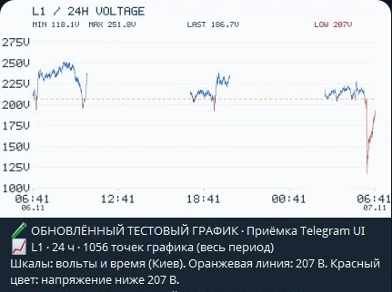
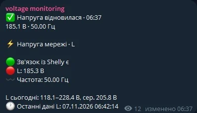

# Telegram field screenshots — 7 November 2026

These are **real Telegram screenshots provided by the operator**, cropped to
the message boundaries and recompressed to WebP. No textual labels or voltage
values were redrawn or fabricated. Unrelated Telegram chrome, avatar and
forward controls were removed from the crop.

The captured measurements are **historical**. Shelly connectivity can become
offline; **the screenshots are not current voltage readings**.

## 24-hour voltage chart — visually inspected

- Telegram photo from the physical Shelly Pro EM-50 on 2026-11-07
- 1,056 plotted points over the full last-24-hour interval, not 1,056
  total stored samples
- Labeled voltage/time axes, measured minimum/maximum, last historical
  voltage and orange **207 V configured warning threshold**
- Red segments indicate measurements below that warning threshold
- Chart code in PR #175 was tested independently of the public live bot
- Original crop SHA256:
  `3630dd91b294513936ea234b7f10bc9f19e9b70f77fd78cecb77a520c09bcba0`

## Historical status message — accepted defect reproduction, not a final design

**DO NOT PRESENT THIS STATUS AS CURRENT CORRECT BEHAVIOR.** This screenshot
shows a real visual defect: a green "Напруга відновилася" headline at **185.1 V**
despite a red L phase at **185.3 V**. Voltage was still critically low
according to the configured critical threshold. PR #176 fixes the headline to
reflect the measured voltage's severity rather than low-alert hysteresis.
PR #177 also suppresses historical recovery banners during Shelly
connectivity outages.

- This is human evidence of the **pre-fix version**
- Real voltage measurements were retained unmodified
- Original crop SHA256:
  `cd83f8b182e444fc78d074968f1c510f317bdb3713b6bc9a584704ef5dbc881a`

## Acceptance and release constraints

- The screenshots show Telegram client rendering, **not** proof that the
  corrected code has been deployed or observed in the public channel.
- The source-only integrated QA candidate remains separated from
  production. Public `main` and the published release have not been promoted.
- Current out-of-power periods require an explicit offline state: last
  valid voltage must never be mistaken for live voltage.
- Do not use these screenshots to infer unverified mains outage timing or
  exact DTEK schedules.
- Require operator-visible acceptance after deployment, review of PR #172,
  physical alternative-Shelly-model acceptance and the remaining official
  schedule/release approvals before promotion.

Related staging PRs: [#175](https://github.com/iSentinel/shelly-voltage-telegram/pull/175),
[#176](https://github.com/iSentinel/shelly-voltage-telegram/pull/176),
[#177](https://github.com/iSentinel/shelly-voltage-telegram/pull/177).
