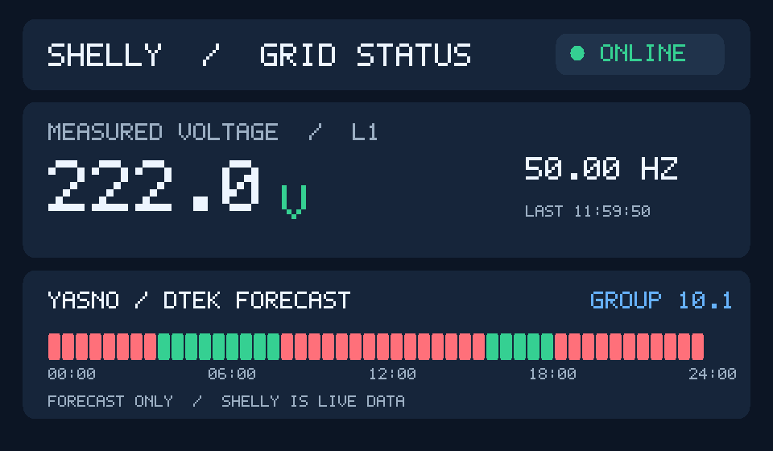

# Telegram graphical status card v2 — source-only development

Status: **implemented in the separate source branch, NOT deployed**.
The installed 0.5.15-hw service and its stable channel status are unchanged.

## Design

The initial supported transport is a Telegram PNG photo with a text
caption, independent of experimental Telegram native HTML widgets and
external graphics dependencies. Only Python standard-library and existing,
tested RGB/PNG utilities are required.

**The example uses fictional 222.0 V, 50.0 Hz and fabricated schedule slots.
It is NOT real meter telemetry or the official YASNO timetable.**

The card shows the connection state, large L1 reading, frequency,
timestamp and 48 half-hour forecast segments. Forecast outages are red;
scheduled power is green; uncertain periods are amber. It explicitly
separates the forecast from actual Shelly measurements.

- Voltage is live only when Shelly is online and its sample is valid,
  finite and no older than 60 seconds.
- Offline, stale, invalid or unknown values render --- V. Never display
  the last historical voltage as a live reading.
- YASNO is displayed only for a verified local cache of today's Kyiv
  date, at most two hours old, with 48 valid half-hour slots.
- If the schedule expires, display NO CURRENT FORECAST, independently
  from whether the Shelly device is online.
- The image is deterministic, at 960 x 560 RGB and networkless.

## Initial private administrator command

The new candidate command is /graphic_preview in an authenticated private
admin chat. It is NOT available in the installed 0.5.15-hw release.

One snapshot and verified local cache are rendered into a temporary PNG.
A single silent Telegram photo is sent explicitly to that admin's chat.
The temp file is deleted after upload. The PNG uses ASCII labels; the
accessible caption uses Ukrainian, Russian or English bot localization.

Public-channel messages and non-administrator requests cannot trigger it.
No public message, pin, database, device control or timer is changed.

## Isolated acceptance

Run from the source tree with the project's quality environment:

    python3 -m unittest discover -s tests -p test_telegram_card_png.py -v
    python3 -m unittest discover -s tests -p test_private_graphic_preview.py -v
    PYTHON_BIN=python3 bash scripts/quality.sh
    python3 -m unittest discover -s tests -p test_*.py -q

Manual local render (no Telegram send/edit):

    python3 telegram_card_png.py --state-file STATE.json --output /tmp/status.png

The state file must contain a validated schema-1 JSON widget state.

## Future channel rollout (not enabled)

Before implementing channel photo edits, require an explicit owner opt-in,
a separate photo message ID, safe text fallback and verified rollback.
A text message cannot be assumed to be convertible into photo media.
Guard against duplicate posts, excessive updates and unapproved pins.
Require Bot API acceptance, actual recipient-visible Android validation,
SQLite parity and a NEW owner-approved production maintenance window.
